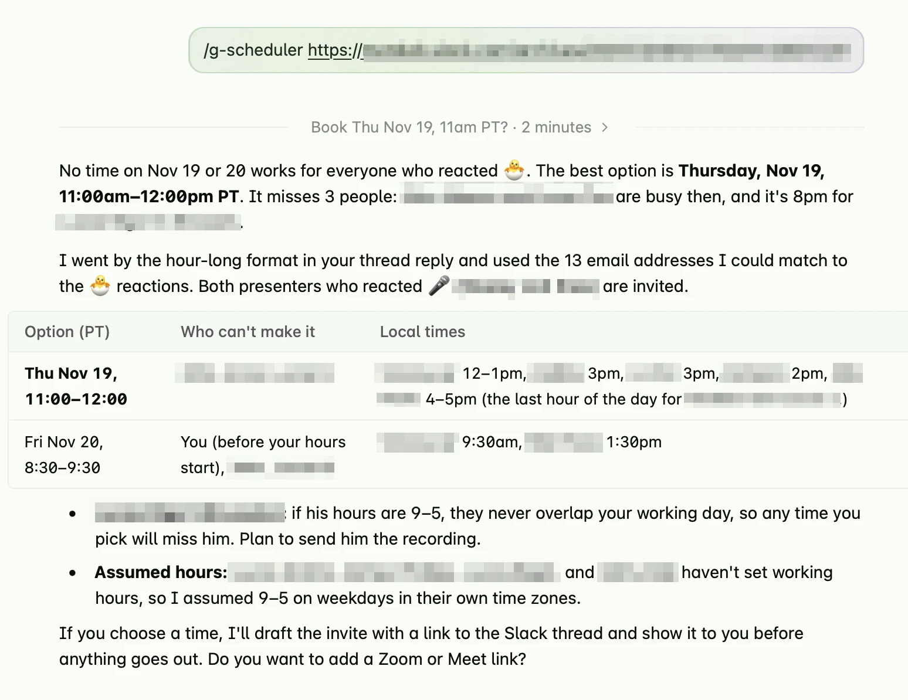

# g-scheduler

An agent skill that finds good meeting times for a group of Google Workspace users. It respects each person's Google Calendar working hours and time zone, and it can send the invite.

```bash
npx skills add paulstraw/g-scheduler
```

Then ask your agent something like:

> /g-scheduler find an hour in the next two weeks for everyone who reacted 👍 to https://example.slack.com/archives/C123/p456

The agent resolves the people to email addresses (here with its Slack tools), reads their working hours and free/busy, and suggests a few slots with each person's local time. If you ask, it previews the invite and sends it after you confirm.



## Requirements

- An agent with a shell and network access: Claude Code, or the Code tab in Claude Desktop. The Chat tab in Claude Desktop, claude.ai, and cloud Cowork are not supported.
- Python 3.9+.
- Google's [`gws`](https://github.com/googleworkspace/cli) CLI, signed in with a Google Workspace account. The skill walks you through setup on first use; see [SETUP.md](skills/g-scheduler/SETUP.md).

## How it decides

- A slot must be free for every required attendee and inside each one's working hours.
- People with no working hours set are assumed to work 09:00-17:00 on weekdays in their own time zone, and the results say so.
- Earlier days rank first. Within a day, slots that avoid the first and last 30 minutes of someone's day rank higher.
- If no slot works for everyone, it shows the slots that miss the fewest people and names them.

## Development

```bash
python3 -m unittest discover -s tests -v
```

See [AGENTS.md](AGENTS.md) for conventions.
